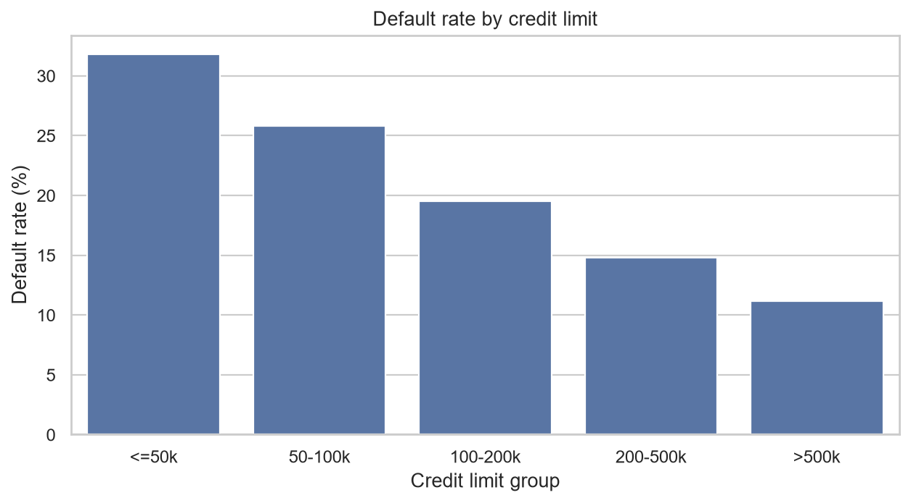
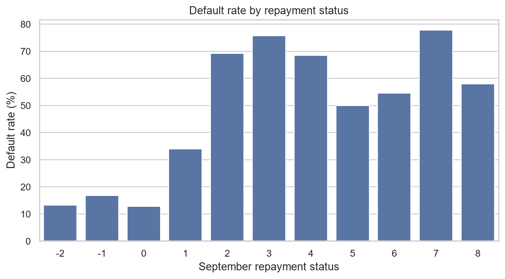
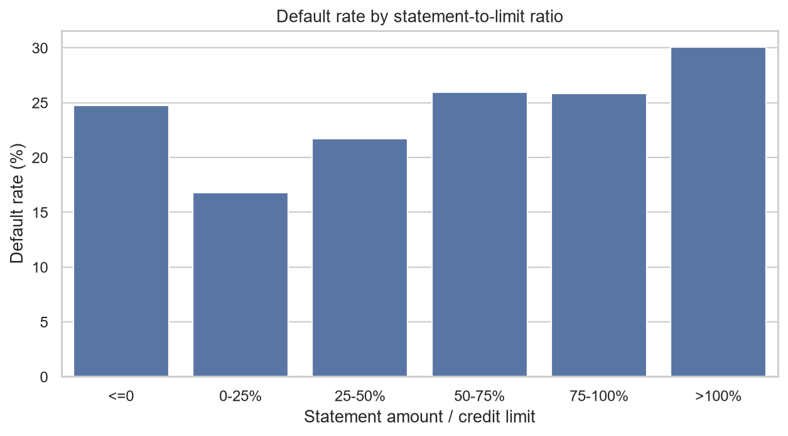
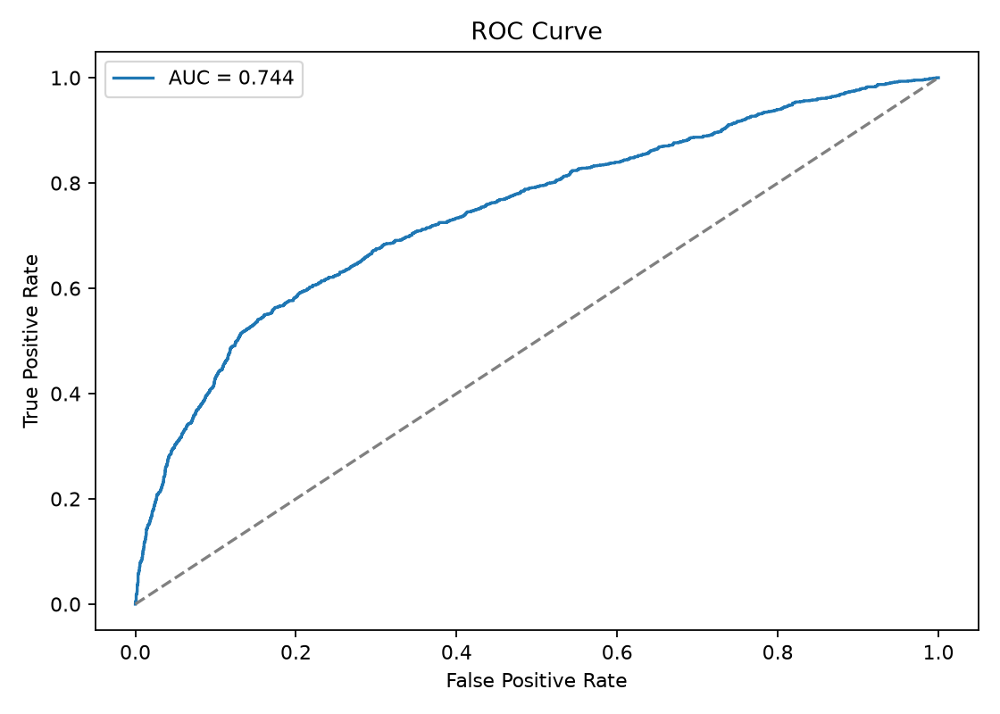
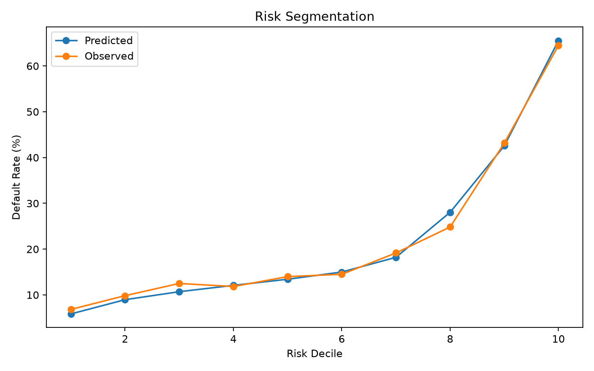
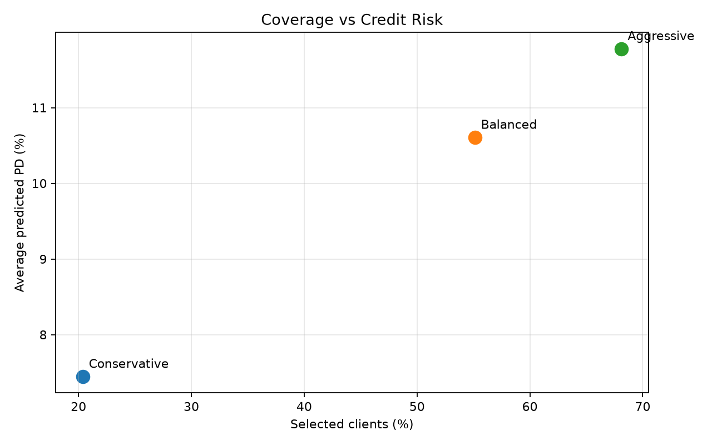

# Анализ кредитного риска и оптимизация кредитных лимитов

**Pet-проект по продуктовой и риск-аналитике**

## О проекте

Проект посвящён анализу кредитного риска держателей кредитных карт, прогнозированию вероятности дефолта и исследованию стратегий управления кредитными лимитами.

На основе исторических банковских данных проводится исследовательский анализ (EDA), выявляются факторы, связанные с риском невозврата задолженности, и строится модель логистической регрессии.

Полученные прогнозы используются для сегментации клиентов и сравнения стратегий отбора кандидатов на увеличение кредитных лимитов. Дополнительно проводится сценарная оценка кредитных потерь и разрабатывается дизайн A/B-теста для проверки продуктовой гипотезы.

### Используемые технологии

- **Python:** Pandas, NumPy, Scikit-learn, SciPy, Matplotlib, Seaborn.
- **SQL (DuckDB):** аналитические запросы, группировка и агрегация данных.
- **Статистические методы:** исследовательский анализ данных, логистическая регрессия, оценка качества бинарной классификации, расчёт размера выборки для A/B-теста.

## 1. Постановка задачи

### 1.1. Бизнес-контекст

Управление кредитным риском — одна из ключевых задач банка при работе с кредитными продуктами.

С одной стороны, банк заинтересован в увеличении использования кредитных карт и объёмов кредитования. С другой стороны, расширение кредитования может сопровождаться ростом просроченной задолженности и финансовых потерь.

Одним из инструментов стимулирования активности клиентов является увеличение доступного кредитного лимита. Однако подобные решения требуют предварительной оценки риска невозврата задолженности.

**Основной вопрос исследования:** можно ли на основе характеристик клиента и истории его платежей оценить вероятность дефолта и использовать полученные прогнозы для выбора стратегии управления кредитными лимитами?

### 1.2. Цель проекта

Разработать модель прогнозирования вероятности дефолта клиентов кредитных карт и исследовать возможности её применения для сегментации клиентов и сравнения стратегий управления кредитными лимитами.

### 1.3. Задачи исследования

1. Провести проверку качества данных и исследовательский анализ (EDA).
2. Изучить зависимости между кредитным лимитом, задолженностью, историей платежей и частотой дефолтов.
3. Подготовить данные и создать дополнительные признаки для моделирования.
4. Построить модель логистической регрессии для оценки вероятности дефолта (Probability of Default, PD).
5. Оценить качество модели и сегментировать клиентов по уровню риска.
6. Сравнить стратегии отбора клиентов с различными порогами допустимой PD.
7. Провести сценарную оценку ожидаемых кредитных потерь.
8. Разработать дизайн A/B-теста для проверки эффективности увеличения кредитных лимитов.

## 2. Описание данных

**Источник:** [Default of Credit Card Clients — UCI Machine Learning Repository](https://archive.ics.uci.edu/dataset/350/default+of+credit+card+clients).

Датасет содержит информацию о **30 000 держателях кредитных карт** банка Тайваня за 2005 год.

В набор входят данные о кредитных лимитах, демографических характеристиках клиентов, выставленных счетах и платежах за апрель–сентябрь 2005 года.

**Целевая переменная:** `default` — факт дефолта по платежу в следующем месяце (октябрь 2005 года):

- `0` — дефолт отсутствует;
- `1` — дефолт произошёл.

Основные признаки:

| Признак | Описание |
|---|---|
| `LIMIT_BAL` | Размер предоставленного кредитного лимита |
| `SEX` | Пол клиента |
| `EDUCATION` | Уровень образования |
| `MARRIAGE` | Семейное положение |
| `AGE` | Возраст клиента |
| `PAY_0`, `PAY_2`–`PAY_6` | Статусы погашения задолженности за последние шесть месяцев |
| `BILL_AMT1`–`BILL_AMT6` | Суммы ежемесячных счетов |
| `PAY_AMT1`–`PAY_AMT6` | Суммы произведённых платежей |

Все денежные значения представлены в новых тайваньских долларах (NTD).

## 3. Исследовательский анализ данных (EDA)

### 3.1. Проверка качества данных

Датасет содержит 30 000 наблюдений, 23 объясняющих признака, идентификатор клиента и целевую переменную.

По результатам проверки:

- Пропущенные значения отсутствуют.
- Дублирующиеся записи отсутствуют.
- Дублирующиеся идентификаторы клиентов отсутствуют.
- Все признаки имеют числовой тип данных.

При этом обнаружены особенности кодирования категориальных переменных:

- `EDUCATION` содержит значения `0`, `5` и `6`, не предусмотренные основным описанием категорий.
- `MARRIAGE` содержит значение `0`, не предусмотренное стандартной кодировкой.

Для последующего моделирования нестандартные значения объединены с категорией Other/Unknown.

### 3.2. Общая доля дефолтов

Из 30 000 клиентов **6 636 допустили дефолт** в следующем месяце.

Общая доля дефолтов составляет **22,12%**.

Таким образом, распределение целевой переменной несбалансированно: около 78% наблюдений относятся к клиентам без дефолта.

### 3.3. Зависимость дефолта от кредитного лимита

| Кредитный лимит (NTD) | Количество клиентов | Доля дефолтов |
|---|---:|---:|
| До 50 000 | 7 676 | 31,79% |
| 50 000–100 000 | 4 822 | 25,80% |
| 100 000–200 000 | 7 880 | 19,48% |
| 200 000–500 000 | 9 416 | 14,80% |
| Более 500 000 | 206 | 11,17% |

Наблюдается отрицательная связь между величиной кредитного лимита и частотой дефолтов.

Доля дефолтов снижается с 31,79% среди клиентов с небольшими лимитами до 11,17% среди клиентов с лимитами выше 500 000 NTD.

Однако эта зависимость не доказывает, что увеличение кредитного лимита само по себе снижает вероятность дефолта. Возможно, банк изначально предоставляет более высокие лимиты клиентам с лучшей кредитной историей и платёжеспособностью.

### 3.4. Зависимость дефолта от истории платежей

Статус погашения задолженности за сентябрь (`PAY_0`) демонстрирует выраженную связь с частотой дефолтов.

| Статус платежа | Количество клиентов | Доля дефолтов |
|---|---:|---:|
| -2 | 2 759 | 13,23% |
| -1 | 5 686 | 16,78% |
| 0 | 14 737 | 12,81% |
| 1 | 3 688 | 33,95% |
| 2 | 2 667 | 69,14% |
| 3 | 322 | 75,78% |

**Положительные значения статуса просрочки связаны со значительно более высокой частотой дефолтов.**

Например, среди клиентов со статусом `PAY_0 = 0` доля дефолтов составляет 12,81%, тогда как при `PAY_0 = 2` она достигает 69,14%.

При этом категории с высокими значениями статуса просрочки содержат небольшое количество наблюдений, поэтому оценки для них могут быть нестабильными.

### 3.5. Совместное влияние кредитного лимита и просрочек

Анализ показывает, что наличие положительного статуса просрочки связано с повышенной частотой дефолтов во всех группах кредитных лимитов.

Например, среди клиентов с лимитами от 200 000 до 500 000 NTD:

- При `PAY_0 ≤ 0` доля дефолтов составляет 10,36%.
- При `PAY_0 ≥ 1` доля дефолтов составляет 39,90%.

Таким образом, история платежей позволяет дополнительно разделять клиентов по уровню риска даже внутри одной группы кредитных лимитов.

Это подтверждает целесообразность использования нескольких характеристик клиента при построении модели кредитного риска.

### 3.6. Отношение суммы выставленного счёта к кредитному лимиту

Для исследования долговой нагрузки рассчитан дополнительный показатель:

`bill_to_limit = BILL_AMT1 / LIMIT_BAL`

| Отношение счёта к лимиту | Количество клиентов | Доля дефолтов |
|---|---:|---:|
| ≤ 0% | 2 598 | 24,75% |
| 0–25% | 11 440 | 16,81% |
| 25–50% | 3 588 | 21,74% |
| 50–75% | 3 579 | 25,96% |
| 75–100% | 6 680 | 25,82% |
| Более 100% | 2 115 | 30,07% |

Наименьшая доля дефолтов (16,81%) наблюдается среди клиентов, у которых сумма сентябрьского счёта составляет от 0% до 25% кредитного лимита.

При увеличении этого отношения частота дефолтов в целом возрастает, достигая 30,07% в группе со значениями выше 100%.

Однако зависимость не является строго монотонной: клиенты с нулевыми или отрицательными суммами счетов также демонстрируют относительно высокую частоту дефолтов.

Показатель `bill_to_limit` рассматривается как приближённая характеристика долговой нагрузки, а не как точная доля использованного кредитного лимита.

### 3.7. Основные выводы EDA

По результатам исследовательского анализа выявлены следующие закономерности:

1. Общая доля дефолтов составляет 22,12%.
2. Клиенты с меньшими кредитными лимитами в среднем чаще допускают дефолт.
3. История просрочек демонстрирует выраженную связь с последующим дефолтом.
4. Наличие положительного статуса просрочки связано с повышенным риском во всех группах кредитных лимитов.
5. Высокое отношение суммы выставленного счёта к кредитному лимиту в целом связано с повышенной частотой дефолтов.

Полученные результаты использованы при выборе и конструировании признаков для модели кредитного риска.

## 4. Моделирование кредитного риска

### 4.1. Выбор модели

Для прогнозирования вероятности дефолта использована **логистическая регрессия (Logistic Regression)**.

Выбор модели обусловлен её простотой, интерпретируемостью и возможностью получения вероятностных прогнозов.

В рамках задачи необходимо не только классифицировать клиентов, но и оценивать вероятность дефолта для последующей сегментации по уровню риска.

### 4.2. Подготовка признаков

На основе исходных данных созданы дополнительные признаки:

| Признак | Описание |
|---|---|
| `late_months` | Количество месяцев с положительным статусом просрочки |
| `max_delay` | Максимальный статус просрочки за рассматриваемый период |
| `avg_bill` | Средняя сумма выставленных счетов |
| `avg_payment` | Средняя сумма ежемесячных платежей |
| `bill_to_limit` | Отношение сентябрьского счёта к кредитному лимиту |

Для числовых признаков применена стандартизация, для категориальных — One-Hot Encoding с исключением одной dummy-переменной для каждого категориального признака.

Предобработка данных и обучение модели объединены в единый Pipeline.

Данные разделены на три части с сохранением доли дефолтов:

- 60% — обучающая выборка;
- 20% — валидационная выборка;
- 20% — тестовая выборка.

После сравнения моделей финальная логистическая регрессия обучена на объединённых обучающей и валидационной выборках (80% наблюдений).

### 4.3. Оценка качества модели

Для оценки качества использованы следующие метрики:

- **ROC-AUC** — качество ранжирования клиентов по вероятности дефолта.
- **Average Precision** — качество выявления дефолтов на разных порогах классификации.
- **Brier Score** — точность вероятностных прогнозов.
- **Log Loss** — качество вероятностных прогнозов с повышенным штрафом за уверенные ошибки.
- **Precision и Recall** — характеристики бинарной классификации при выбранном пороге.

Для сравнения использована константная модель DummyClassifier, прогнозирующая одинаковую вероятность дефолта для всех клиентов.

Результаты финальной логистической регрессии на тестовой выборке:

| Метрика | Значение |
|---|---:|
| ROC-AUC | 0,7443 |
| Average Precision | 0,5044 |
| Brier Score | 0,1426 |
| Log Loss | 0,4515 |
| Precision при пороге 0,5 | 0,64 |
| Recall при пороге 0,5 | 0,29 |

Модель демонстрирует способность различать клиентов с разным уровнем кредитного риска: ROC-AUC составляет 0,7443.

Average Precision равен 0,5044, что существенно превышает долю дефолтов в тестовой выборке (0,2212).

По сравнению с константной моделью Brier Score снизился с 0,1723 до 0,1426.

При стандартном пороге классификации 0,5 модель обнаруживает только 29% клиентов, допустивших дефолт.

Это показывает необходимость выбора порога классификации с учётом конкретных бизнес-ограничений и стоимости ошибок.

### 4.4. Сегментация клиентов по уровню риска

На основе предсказанной вероятности дефолта тестовая выборка разделена на десять равных групп (децилей).

Первый дециль включает клиентов с минимальной прогнозируемой вероятностью дефолта, десятый — с максимальной.

Фактическая доля дефолтов составляет:

- **6,83%** в первом дециле;
- **64,50%** в десятом дециле.

Таким образом, частота дефолтов в наиболее рискованной группе примерно в 9,4 раза выше, чем в наименее рискованной.

Средние предсказанные вероятности близки к фактическим долям дефолтов в большинстве децилей, что указывает на удовлетворительную калибровку модели на уровне сегментов.

### 4.5. Интерпретация признаков

Анализ коэффициентов логистической регрессии показал:

- Количество месяцев с просрочками (`late_months`) имеет положительный коэффициент.
- Максимальный статус просрочки (`max_delay`) также имеет положительный коэффициент.
- Кредитный лимит (`LIMIT_BAL`) имеет отрицательный коэффициент.
- Сумма последнего платежа (`PAY_AMT1`) имеет отрицательный коэффициент.

Полученные результаты в целом согласуются с закономерностями, выявленными в ходе EDA.

Однако интерпретация отдельных коэффициентов ограничена корреляцией признаков: например, количество месяцев с просрочками связано с отдельными статусами платежей.

Поэтому коэффициенты модели не следует интерпретировать как независимые причинные эффекты.

## 5. Бизнес-анализ и оценка стратегий управления кредитными лимитами

### 5.1. Постановка бизнес-задачи

На основе построенной модели кредитного риска необходимо определить, какие группы клиентов можно рассматривать в качестве кандидатов для потенциального увеличения кредитных лимитов.

Увеличение лимита может способствовать росту использования кредитных карт и процентных доходов банка, однако одновременно может увеличивать кредитную экспозицию и потенциальные убытки.

Для принятия решения необходимо учитывать два показателя:

- **Охват клиентов** — долю клиентской базы, подходящую под выбранные критерии.
- **Кредитный риск** — прогнозируемую вероятность дефолта выбранных клиентов.

Основная задача данного этапа — исследовать компромисс между охватом клиентской базы и кредитным риском при различных порогах PD.

### 5.2. Сравнение стратегий отбора клиентов

Рассмотрены три стратегии, различающиеся максимально допустимой прогнозируемой вероятностью дефолта:

| Стратегия | Условие отбора | Характеристика |
|---|---|---|
| Conservative | PD ≤ 10% | Минимизация кредитного риска |
| Balanced | PD ≤ 15% | Компромисс между риском и охватом |
| Aggressive | PD ≤ 20% | Расширение потенциальной аудитории |

Для каждой стратегии рассчитаны количество подходящих клиентов, охват тестовой выборки, средняя прогнозируемая PD, фактическая частота дефолтов и средний кредитный лимит.

**Результаты сравнения:**

| Показатель | Conservative | Balanced | Aggressive |
|---|---:|---:|---:|
| Количество клиентов | 1 222 | 3 307 | 4 087 |
| Охват выборки | 20,37% | 55,12% | 68,12% |
| Средняя прогнозируемая PD | 7,45% | 10,61% | 11,78% |
| Фактическая доля дефолтов | 8,51% | 11,25% | 12,53% |
| Средний кредитный лимит (NTD) | 318 674 | 214 381 | 192 030 |

**Анализ результатов**

Консервативная стратегия обеспечивает минимальную среднюю вероятность дефолта — 7,45%, однако охватывает только 20,37% клиентской базы.

При переходе к сбалансированной стратегии количество потенциальных участников увеличивается с 1 222 до 3 307 человек, а охват — с 20,37% до 55,12%. При этом средняя прогнозируемая PD увеличивается на 3,16 процентного пункта.

Агрессивная стратегия расширяет охват до 68,12%, однако сопровождается дальнейшим ростом средней PD и фактической частоты дефолтов.

Таким образом, смягчение ограничений по кредитному риску позволяет расширить потенциальную аудиторию программы, но приводит к увеличению среднего риска выбранной группы.

### 5.3. Сценарная оценка ожидаемых кредитных потерь

Для оценки потенциальных кредитных потерь использована формула ожидаемого убытка:

**EL = PD × LGD × EAD**,

где:

- **PD (Probability of Default)** — вероятность дефолта;
- **LGD (Loss Given Default)** — доля задолженности, которая будет потеряна в случае дефолта;
- **EAD (Exposure at Default)** — величина задолженности на момент дефолта.

Для расчётов приняты следующие гипотетические параметры:

| Параметр | Значение |
|---|---:|
| Увеличение кредитного лимита | 20 000 NTD |
| Предполагаемая доля использования дополнительного лимита | 50% |
| LGD | 60% |
| Дополнительная кредитная экспозиция на клиента | 10 000 NTD |

Ожидаемые потери по каждому клиенту рассчитываются как произведение его прогнозируемой PD, LGD и дополнительной кредитной экспозиции.

**Результаты сценарного моделирования:**

| Стратегия | Ожидаемые потери (NTD) | Потери на выбранного клиента (NTD) |
|---|---:|---:|
| Conservative | 545 925 | 446,75 |
| Balanced | 2 104 545 | 636,39 |
| Aggressive | 2 888 451 | 706,74 |

Совокупные ожидаемые потери возрастают по мере расширения аудитории программы.

При этом увеличиваются и средние ожидаемые потери на выбранного клиента: с 446,75 NTD при консервативной стратегии до 706,74 NTD при агрессивной.

Полученные результаты демонстрируют зависимость сценарных кредитных потерь от выбранного порога риска.

**Ограничение:** расчёт предполагает, что вероятность дефолта клиента не изменяется после увеличения кредитного лимита. Следовательно, полученные значения не являются оценкой фактического прироста убытков вследствие изменения лимита.

Для более точного расчёта необходимы данные о поведении клиентов после увеличения лимита, фактической задолженности на момент дефолта и параметрах взыскания.

### 5.4. Выбор стратегии

На основании проведённого анализа сбалансированная стратегия с порогом **PD ≤ 15%** рассматривается как кандидат для дальнейшего тестирования.

Её основные характеристики:

- Охват — 55,12% тестовой выборки.
- Средняя прогнозируемая PD — 10,61%.
- Фактическая доля дефолтов — 11,25%.
- Сценарные ожидаемые потери на выбранного клиента — 636,39 NTD.

Данная стратегия обеспечивает существенно больший охват по сравнению с консервативным вариантом при умеренном увеличении среднего прогнозируемого риска.

Однако выбор стратегии нельзя считать окончательным без оценки доходности клиентов и эффекта увеличения кредитных лимитов.

Для проверки бизнес-гипотезы предлагается проведение A/B-теста.

### 5.5. Проектирование A/B-теста

**Цель эксперимента:** проверить, приводит ли предложение увеличить кредитный лимит к росту использования кредитной карты без неприемлемого увеличения кредитного риска.

**Гипотеза:** предложение повысить кредитный лимит увеличит долю активных пользователей кредитного продукта.

**Дизайн эксперимента**

В эксперимент включаются клиенты, прошедшие предварительный риск-отбор.

Участники случайным образом распределяются на две группы:

- **Контрольная группа (A):** кредитный лимит остаётся неизменным.
- **Экспериментальная группа (B):** клиенту предлагается увеличение кредитного лимита на 20 000 NTD.

Рандомизация проводится на уровне клиента. Основной анализ предполагается выполнять по первоначальному назначению в экспериментальные группы (intention-to-treat).

**Основная продуктовая метрика**

Доля клиентов, воспользовавшихся кредитными средствами в течение установленного периода наблюдения.

**Дополнительные метрики**

| Метрика | Назначение |
|---|---|
| Средняя задолженность | Оценка изменения использования кредитного продукта |
| Объём операций | Оценка изменения активности клиентов |
| Доля просрочек 30+ дней | Контроль кредитного риска |
| Финансовый результат | Оценка экономического эффекта с учётом доходов и затрат |

**Расчёт размера выборки**

Для предварительного расчёта используются следующие гипотетические параметры:

| Параметр | Значение |
|---|---:|
| Базовая доля активации | 20% |
| Ожидаемая доля активации | 23% |
| Минимально значимый эффект (MDE) | +3 процентных пункта |
| Уровень значимости (α) | 0,05 |
| Статистическая мощность | 80% |
| Размер одной группы | 2 943 |
| Общий размер выборки | 5 886 |

Расчёт выполнен для сравнения двух независимых долей при равном распределении участников между группами.

Предполагаемый эффект +3 процентных пункта является иллюстративным, поскольку исходный датасет не содержит информации об изменении активности клиентов после повышения кредитного лимита.

**Ограничения эксперимента**

При использовании сбалансированной стратегии в тестовой выборке доступно только 3 307 подходящих клиентов, что недостаточно для рассчитанной общей выборки в 5 886 участников.

В реальных условиях эксперимент потребует большей доступной клиентской базы либо пересмотра статистических параметров исследования.

Кроме того, оценка краткосрочной активности клиентов и кредитных потерь может требовать разных периодов наблюдения. Риск-метрики необходимо отслеживать достаточно долго, чтобы выявить возможные просрочки после увеличения лимита.

### 5.6. Выводы бизнес-анализа

1. Построенная модель позволяет сегментировать клиентов по прогнозируемой вероятности дефолта и использовать эту информацию для предварительного риск-отбора.
2. Снижение строгости порогов PD расширяет охват клиентской базы, одновременно увеличивая средний кредитный риск.
3. Сбалансированная стратегия с PD ≤ 15% обеспечивает охват 55,12% клиентов при средней прогнозируемой PD 10,61%.
4. Сценарная оценка показывает увеличение ожидаемых кредитных потерь при расширении аудитории программы.
5. Для выбора экономически оптимальной стратегии необходимо учитывать доходность клиентов, стоимость фондирования, кредитные потери и изменение поведения после увеличения лимита.
6. Проверить эффективность повышения кредитных лимитов предлагается посредством рандомизированного A/B-теста.

## 6. Ограничения исследования

1. Используются данные банка Тайваня за 2005 год. Выявленные закономерности могут отличаться от характеристик современных банковских клиентов.

2.  Обнаруженные зависимости не доказывают, что изменение кредитного лимита или других характеристик непосредственно влияет на вероятность дефолта.

3. Некоторые значения категориальных признаков имеют нестандартную кодировку, а отдельные группы содержат небольшое количество наблюдений.

4. Использовано случайное разделение данных, а не проверка на последующем временном периоде. Кроме того, тестовая выборка анализировалась в ходе разработки, что ограничивает независимость итоговой оценки.

5. Параметры LGD и дополнительной кредитной экспозиции заданы гипотетически. Модель не учитывает возможное изменение вероятности дефолта при повышении кредитного лимита.

6. Исходный датасет не позволяет непосредственно измерить влияние повышения кредитных лимитов на активность клиентов и финансовые результаты банка.

## 7. Заключение

В рамках проекта проведён исследовательский анализ данных 30 000 клиентов кредитных карт, разработана модель прогнозирования вероятности дефолта и исследованы стратегии управления кредитными лимитами.

В ходе EDA выявлены связи между кредитным риском, величиной кредитного лимита, историей просрочек и отношением выставленного счёта к лимиту.

Построенная логистическая регрессия достигла **ROC-AUC = 0,7443** и **Average Precision = 0,5044** на тестовой выборке, существенно превзойдя константную модель.

На основе прогнозируемых вероятностей дефолта выполнена сегментация клиентов по уровню риска и проведено сравнение трёх стратегий предварительного отбора кандидатов на увеличение лимита.

В качестве кандидата для дальнейшего исследования предложена сбалансированная стратегия с порогом PD ≤ 15%, охватывающая 55,12% клиентов тестовой выборки.

Дополнительно проведена сценарная оценка ожидаемых кредитных потерь и разработан дизайн A/B-теста для проверки продуктовой гипотезы.
